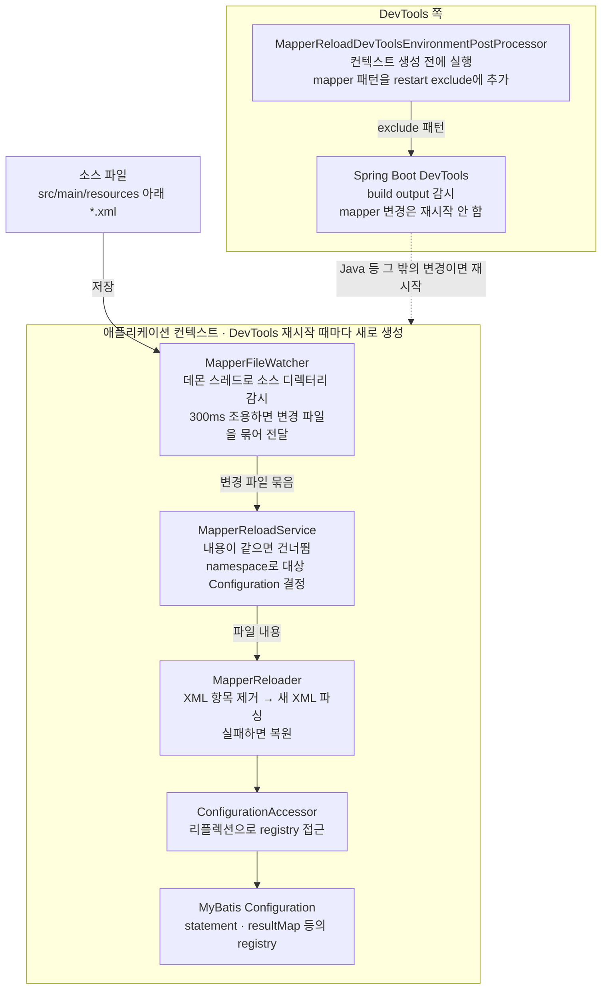
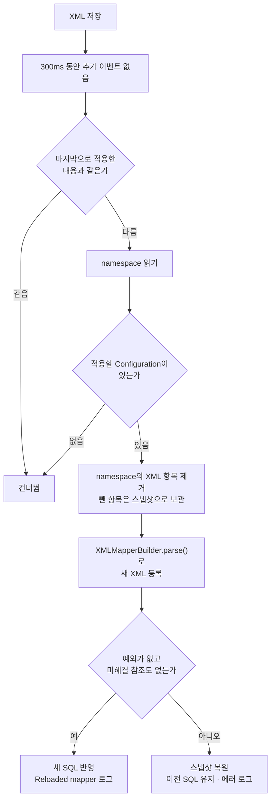

# MyBatis mapper XML 리로드: 과정과 아키텍처

mapper XML만 고쳤을 때 애플리케이션을 재시작하지 않고 SQL을 바꾸는 과정과, 그 일을 하는 클래스들의 구조를 정리합니다. 사용법과 속성 표는 [README](../README.md)가 기준이고, 이 문서는 "안에서 실제로 무슨 일이 일어나는가"를 설명합니다. 클래스 경로는 모두 `mybatis-devtools-reload/src/main/java/io/devreload/mybatis/` 기준입니다.

## 목차

1. [한눈에 보기](#1-한눈에-보기)
2. [배경 지식](#2-배경-지식)
3. [전체 구조](#3-전체-구조)
4. [리로드 과정](#4-리로드-과정)
5. [안전장치](#5-안전장치)
6. [DevTools와의 역할 분담](#6-devtools와의-역할-분담)
7. [제약과 주의할 점](#7-제약과-주의할-점)

---

## 1. 한눈에 보기

mapper XML을 저장하면 애플리케이션을 재시작하지 않고, 그 파일의 namespace에 속한 SQL만 MyBatis 메모리에서 새것으로 갈아 끼웁니다.

| 무엇을 고쳤나 | 누가 처리하나 | 어떻게 되나 |
|---|---|---|
| Java 코드 | Spring Boot DevTools | 애플리케이션 재시작 (기존 그대로) |
| mapper XML | 이 라이브러리 | 저장 0.3초쯤 뒤에 해당 namespace만 교체 |
| 잘못된 mapper XML | 이 라이브러리 | 교체를 취소하고 이전 SQL로 계속 동작 |

로컬 개발 환경에서만 켜는 기능입니다(`mybatis-reload.enabled: true`, 기본값은 꺼짐).

## 2. 배경 지식

### MyBatis는 XML을 어디에 보관하나

MyBatis는 시작할 때 mapper XML을 한 번 읽어 `Configuration` 객체 안의 Map들에 넣어 두고, 그 뒤로는 파일을 다시 보지 않습니다. 그래서 파일을 고쳐도 실행 중인 애플리케이션의 SQL은 바뀌지 않습니다.

이 Map들을 registry라고 부릅니다. 키는 `namespace.id` 형태입니다(예: `io.devreload.sample.UserMapper.findAll`).

| registry | 담는 것 | 만드는 XML 요소 |
|---|---|---|
| `mappedStatements` | 실행할 SQL 하나하나 | `<select>` `<insert>` `<update>` `<delete>` |
| `resultMaps` | 결과 컬럼과 객체 필드의 매핑 | `<resultMap>`, `resultType` |
| `parameterMaps` | 파라미터 매핑 | `<parameterMap>` |
| `keyGenerators` | 키 생성기 | `<selectKey>` |
| `sqlFragments` | 재사용하는 SQL 조각 | `<sql>` |
| `caches` | 2차 캐시 | `<cache>` |
| `loadedResources` | 이미 읽은 파일 목록 | 파일 자체 |

### 그래서 리로드란

리로드는 결국 **이 Map들에서 한 namespace의 항목을 빼고, 새 XML을 파싱해 다시 넣는 일**입니다. MyBatis는 이런 교체 API를 제공하지 않아서, 리플렉션으로 Map에 직접 접근합니다.

## 3. 전체 구조

저장한 XML은 감시 → 판단 → 교체의 세 단계를 거쳐 `Configuration`에 반영되고, DevTools 쪽에는 "mapper 변경으로는 재시작하지 말라"는 설정만 따로 전달합니다.

| 클래스 | 한 줄 역할 | 알아 둘 점 |
|---|---|---|
| `MapperFileWatcher` | 소스 디렉터리의 `*.xml` 변경을 감지 | build output이 아니라 **소스**를 감시하므로 저장만 하면 됩니다. |
| `MapperReloadService` | 어떤 파일을 어느 `Configuration`에 적용할지 결정 | Spring bean(`SmartLifecycle`)이라 컨텍스트와 함께 시작하고 종료합니다. |
| `MapperReloader` | `Configuration` 하나에서 namespace를 교체 | Spring 없이 단독으로도 쓸 수 있습니다. |
| `ConfigurationAccessor` | MyBatis 내부 registry를 리플렉션으로 꺼냄 | 하위 클래스부터 필드를 찾아 MyBatis-Plus의 `MybatisConfiguration`도 처리합니다. |
| `MapperPathFilter` | `watch-include` 패턴으로 감시할 파일과 디렉터리를 거름 | 감시 디렉터리 기준 상대 경로에 Ant 패턴을 적용합니다. |
| `MapperXml` | XML에서 namespace와 `<cache>` 선언 여부만 먼저 읽음 | DTD를 내려받지 않아 빠릅니다. |
| `MapperReloadDevToolsEnvironmentPostProcessor` | DevTools restart exclude에 mapper 패턴 추가 | bean이 생기기 전에 실행됩니다. |

진입점은 두 개입니다. `MapperReloadDevToolsEnvironmentPostProcessor`는 `META-INF/spring.factories`로, `MapperReloadService`는 auto-configuration(`MapperReloadAutoConfiguration`)으로 등록됩니다.

## 4. 리로드 과정

`UserMapper.xml`의 SQL을 고쳐 저장하면 아래 순서를 거쳐 다음 쿼리부터 새 SQL이 실행됩니다.

1. **변경 감지** (`MapperFileWatcher`)
   - 소스 디렉터리 `src/main/resources` 아래의 `*.xml` 변경 이벤트를 받습니다.
   - 에디터는 파일을 여러 번에 나눠 쓰므로, 300ms 동안 추가 이벤트가 없을 때 변경 파일을 한 묶음으로 넘깁니다.
   - `watch-include` 패턴이 있으면 일치하는 파일만 넘기고, 일치하는 파일이 있을 수 없는 디렉터리는 감시 대상으로 등록하지 않습니다(`MapperPathFilter`).
2. **건너뛸지 판단** (`MapperReloadService`)
   - 파일 내용이 마지막으로 적용한 것과 같으면 아무것도 하지 않습니다.
   - 비어 있는 파일은 쓰는 중일 수 있어 한 번 더 읽어 봅니다.
3. **namespace 확인** (`MapperXml`)
   - XML에서 `<mapper namespace>` 값만 먼저 읽습니다. mapper가 아닌 XML은 여기서 무시합니다.
4. **대상 결정**
   - 그 namespace를 이미 가진 `Configuration`을 고릅니다.
   - 아무도 모르는 새 namespace는 `SqlSessionFactory`가 하나일 때만 등록하고, 여러 개면 건너뜁니다.
5. **기존 항목 제거** (`MapperReloader`)
   - `Configuration`을 잠그고, 그 namespace에서 XML로 정의된 항목만 registry에서 뺍니다.
   - 뺀 항목은 스냅샷으로 보관합니다.
6. **새 XML 파싱**
   - MyBatis가 시작할 때 쓰는 것과 같은 파서인 `XMLMapperBuilder.parse()`로 새 XML을 읽어 registry에 다시 등록합니다.
7. **결과 확인**
   - 성공하면 `Reloaded mapper ... (N statements)` 로그를 남깁니다.
   - 실패하면 스냅샷을 복원하고 에러 로그를 남깁니다.

5~7단계는 `Configuration` 하나를 잠근 채로 진행하므로, 같은 `Configuration`에 대한 리로드가 겹치지 않습니다.

## 5. 안전장치

리로드가 실패해도 애플리케이션은 이전 SQL로 계속 동작하고, XML이 만들지 않은 항목은 처음부터 건드리지 않습니다.

### 실패하면 롤백

- **파싱 예외**: XML 문법 오류처럼 파싱 중 예외가 나면, 중간까지 등록된 항목을 지우고 스냅샷을 복원합니다.
- **해석되지 않은 참조**: 없는 `resultMap`, `cache-ref`, `include`를 가리키면 MyBatis는 예외 없이 "나중에 다시 시도할 목록"(incomplete 큐)에 넣어 둡니다. 그대로 두면 엉뚱한 시점에 실패하므로, 파싱 후 이 큐에 새 항목이 있으면 실패로 보고 롤백합니다.
- **로그**: 실패는 `Failed to reload ... (previous SQL kept)` 메시지로 남습니다.

### 지우지 않는 것

| 대상 | 남기는 이유 |
|---|---|
| `@Select` 등 애노테이션 statement, MyBatis-Plus가 주입한 statement | XML에 없어서 지우면 다시 만들어지지 않습니다. MyBatis가 이들의 resource를 `... .java (best guess)`로 기록하는 것으로 구분합니다. |
| 남은 애노테이션 statement가 참조하는 resultMap, parameterMap | 애노테이션 쪽에서 만든 것이라 XML을 다시 읽어도 생기지 않습니다. |
| cache | 새 XML이 `<cache>`를 선언할 때만 교체합니다. |

### StrictMap을 피해 가는 이유

registry는 `HashMap`을 상속한 `StrictMap`이고, 같은 키를 `put`으로 두 번 넣으면 예외를 던집니다. 그래서 제거는 iterator로, 복원은 중복 검사를 거치지 않는 `putAll`로 합니다.

`StrictMap`은 `findAll` 같은 짧은 키도 함께 저장합니다. 값이 같은 객체인 항목을 모두 찾아, 긴 키와 짧은 키를 함께 지웁니다.

## 6. DevTools와의 역할 분담

Java 변경은 DevTools가, mapper XML 변경은 이 라이브러리가 맡고, 서로 부딪히지 않도록 세 가지를 맞춥니다.

### 재시작 제외

- `MapperReloadDevToolsEnvironmentPostProcessor`가 컨텍스트가 만들어지기 전에 `mapper/**`, `mappers/**`, `**/*Mapper.xml` 패턴을 `spring.devtools.restart.additional-exclude`에 추가합니다.
- 그래서 빌드로 mapper XML이 build output에 복사돼도 DevTools는 재시작하지 않습니다.
- 사용자가 이미 넣어 둔 exclude 값은 유지하고 뒤에 이어 붙입니다.

### 클래스 로더

- DevTools는 애플리케이션 클래스를 restart classloader로 읽고, 재시작할 때마다 이 classloader를 새로 만듭니다.
- XML을 파싱하는 동안 스레드의 context classloader를 애플리케이션 것으로 바꿉니다. `resultType`의 클래스가 애플리케이션이 쓰는 클래스와 같은 것으로 해석되게 하기 위해서입니다.
- 이렇게 하지 않으면 이름은 같지만 서로 다른 클래스가 되어 `ClassCastException`이 납니다.

### 재시작 후의 XML

- 재시작하면 MyBatis는 build output에 있는 XML을 다시 읽고, 이 라이브러리는 그것을 소스와 다시 비교하지 않습니다.
- 재시작을 일으키는 빌드가 리소스도 함께 복사한다고 전제합니다. Eclipse·VS Code의 자동 빌드, IntelliJ의 Build Project, Gradle `classes` 태스크가 그렇습니다.
- 클래스만 컴파일하는 경우(IntelliJ의 파일 단위 Recompile, `compileJava`만 실행)는 지원 범위에서 제외했습니다. 7장을 참고하세요.

### 재시작과 수명

감시 스레드와 서비스는 애플리케이션 컨텍스트의 bean이라, 재시작 때마다 컨텍스트와 함께 닫히고 새로 만들어집니다. 이전 classloader를 붙잡는 스레드나 static 캐시가 남지 않습니다.

## 7. 제약과 주의할 점

- **개발 전용입니다.** registry가 평범한 `HashMap`이라, 리로드하는 순간 다른 스레드의 쿼리가 statement를 잠깐 못 찾을 수 있습니다.
- **작업 디렉터리에 따라 리로드가 꺼질 수 있습니다.**
  - 감시 경로 기본값 `src/main/resources`는 작업 디렉터리(`user.dir`) 기준 상대 경로입니다.
  - 멀티 모듈 프로젝트를 저장소 루트에서 실행하면 경로를 찾지 못해 `MyBatis mapper reload disabled: none of [...] exists` 경고만 남기고 감시를 시작하지 않습니다.
  - 실행 구성의 working directory를 모듈로 맞추거나 `mybatis-reload.watch-dirs`를 지정합니다.
- **리소스 트리가 크면 감시 범위를 좁힙니다.**
  - 감시 비용은 감시 디렉터리 아래의 디렉터리 수에 비례합니다.
  - mapper가 한 디렉터리에 모여 있으면 `watch-dirs`를 그 디렉터리(`src/main/resources/mapper`)로 지정합니다.
  - 한 루트 아래 여러 디렉터리나 파일 이름 규칙으로 고르려면 `watch-include: [mapper/**]`처럼 패턴을 지정합니다.
- **클래스만 컴파일해서 재시작되는 경우는 지원하지 않습니다.**
  - XML을 저장만 해서 메모리의 SQL은 바뀌었지만 build output의 XML은 옛것인 상태에서, 리소스를 복사하지 않는 빌드로 재시작되면 MyBatis가 옛 XML을 읽어 SQL이 예전으로 돌아갑니다.
  - IntelliJ에서 파일 하나만 Recompile하거나 `compileJava`만 실행하는 경우가 해당합니다.
  - 주 사용 환경인 Eclipse와 VS Code의 자동 빌드, IntelliJ의 Build Project는 리소스를 함께 복사하므로 이 경우를 배제하고, 시작 시 소스와 classpath 사본을 비교하던 기능(`sync-on-start`)을 제거했습니다.
  - 이 상황이 되면 전체 빌드를 실행해 build output을 맞춥니다.
- **실행 중에 Gradle 빌드가 돌면 XML만 고쳐도 재시작됩니다.**
  - Gradle의 `processResources`는 파일 하나만 바뀌어도 리소스 전체를 다시 쓰므로, `application.yml` 같은 다른 파일의 수정 시각까지 바뀝니다.
  - DevTools는 그 파일들을 변경으로 보고 재시작합니다. exclude 패턴은 mapper 파일에만 해당하기 때문입니다.
  - XML만 고쳤을 때는 빌드하지 않아도 반영됩니다. IntelliJ에서는 실행 구성의 "On frame deactivation"이 빌드를 일으키는지 확인합니다.
- **mapper 인터페이스에 메서드를 추가하면** Java 변경이므로 DevTools 재시작으로 처리됩니다.
- **namespace 간 참조**: 다른 XML이 `<include refid="other.ns.x">`로 참조하는 `<sql>`을 바꾸면, 참조하는 쪽 XML도 저장해야 반영됩니다. statement는 파싱 시점에 include를 펼쳐서 보관하기 때문입니다.
- **MyBatis 내부 필드 이름에 의존합니다.** 2장의 표에 있는 일곱 필드를 리플렉션으로 다루므로, MyBatis 버전을 올리면 `MapperReloaderTest`로 확인합니다.
